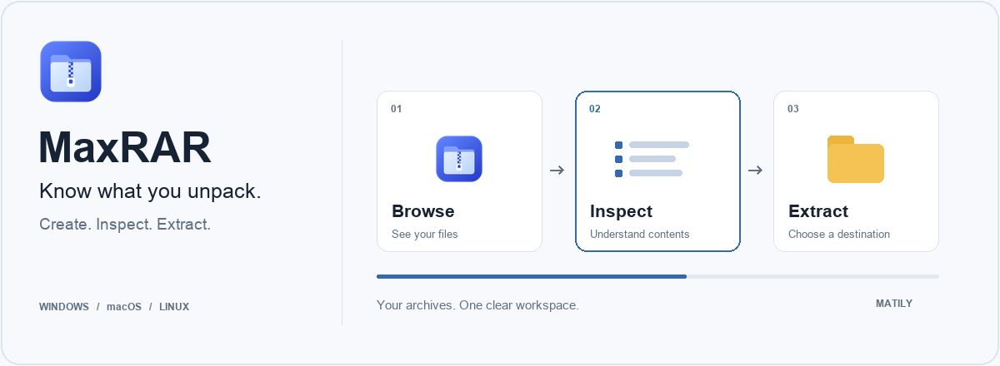

<p align="center">
  
</p>

<p align="center">
  <a href="#download"></a>
  <a href="docs/USER-MANUAL.md"></a>
  <a href="#run-locally"></a>
  <a href="https://github.com/MatilyLabs/MaxRAR/stargazers"></a>
  <a href="https://github.com/MatilyLabs/MaxRAR/issues/new/choose"></a>
</p>

<p align="center">
  <a href="https://github.com/MatilyLabs/MaxRAR/releases/download/v0.1.1/windows-x86_64-MaxRAR_0.1.1_x64-setup.exe"></a>
  <a href="https://github.com/MatilyLabs/MaxRAR/releases/download/v0.1.1/MaxRAR_0.1.1_macOS_apple-silicon.dmg"></a>
  <a href="https://github.com/MatilyLabs/MaxRAR/releases/download/v0.1.1/MaxRAR_0.1.1_macOS_intel.dmg"></a>
  <a href="https://github.com/MatilyLabs/MaxRAR/releases/tag/v0.1.1"></a>
</p>

<p align="center"><sub>v0.1.1 · Not sure which Mac? Apple menu → About This Mac · <a href="#first-launch-security-warnings-are-expected">First-launch security warnings</a></sub></p>

# MaxRAR — Archive Manager for Windows, macOS & Linux

**Know what you unpack.**

MaxRAR is a desktop archive manager by [Matily](https://www.matily.org), built with Rust and Tauri. Create ZIP and 7z archives, extract RAR4/RAR5 files, preview supported text before extraction, test archive integrity, and inspect archive contents locally.

[Download](#download) · [Screenshots](#screenshots) · [Supported formats](#supported-formats) · [MRAR](#experimental-mrar) · [User manual](#user-manual) · [CLI](#cli) · [FAQ](#frequently-asked-questions)

<details>
<summary>View the hero without animation</summary>



</details>

## Download

**MaxRAR v0.1.1 is available for testing.** Choose the download for your computer.

<p align="center">
  <a href="https://github.com/MatilyLabs/MaxRAR/releases/download/v0.1.1/windows-x86_64-MaxRAR_0.1.1_x64-setup.exe"></a>
  <a href="https://github.com/MatilyLabs/MaxRAR/releases/download/v0.1.1/MaxRAR_0.1.1_macOS_apple-silicon.dmg"></a>
  <a href="https://github.com/MatilyLabs/MaxRAR/releases/download/v0.1.1/MaxRAR_0.1.1_macOS_intel.dmg"></a>
  <a href="https://github.com/MatilyLabs/MaxRAR/releases/tag/v0.1.1"></a>
</p>

<p align="center"><sub>v0.1.1 · Not sure which Mac? Apple menu → About This Mac · <a href="#first-launch-security-warnings-are-expected">First-launch security warnings</a></sub></p>

[Release notes](https://github.com/MatilyLabs/MaxRAR/releases/tag/v0.1.1) · [All downloads](https://github.com/MatilyLabs/MaxRAR/releases) · [SHA-256 checksums](https://github.com/MatilyLabs/MaxRAR/releases/download/v0.1.1/SHA256SUMS.txt)

| Your computer | Package | Download |
| --- | --- | --- |
| **Windows** — x64 | EXE installer | [Download for Windows](https://github.com/MatilyLabs/MaxRAR/releases/download/v0.1.1/windows-x86_64-MaxRAR_0.1.1_x64-setup.exe) |
| **Mac with Apple Silicon** (M1, M2, M3, M4…) | DMG | [Download for Apple Silicon](https://github.com/MatilyLabs/MaxRAR/releases/download/v0.1.1/MaxRAR_0.1.1_macOS_apple-silicon.dmg) |
| **Mac with Intel** | DMG | [Download for Intel Mac](https://github.com/MatilyLabs/MaxRAR/releases/download/v0.1.1/MaxRAR_0.1.1_macOS_intel.dmg) |
| **Linux** — x64 | DEB / RPM / AppImage | [DEB](https://github.com/MatilyLabs/MaxRAR/releases/download/v0.1.1/MaxRAR_0.1.1_amd64.deb) · [RPM](https://github.com/MatilyLabs/MaxRAR/releases/download/v0.1.1/MaxRAR-0.1.1-1.x86_64.rpm) · [AppImage](https://github.com/MatilyLabs/MaxRAR/releases/download/v0.1.1/linux-x86_64-MaxRAR_0.1.1_amd64.AppImage) |

Not sure which Mac you have? Open **Apple menu → About This Mac**. If it lists a chip such as “Apple M2”, choose Apple Silicon. If it lists an Intel processor, choose Intel.

### First launch: security warnings are expected

MaxRAR is not yet signed with a Windows publisher certificate (Authenticode) and the Mac apps are not Apple-notarized. Windows and macOS will therefore warn you the first time. This is expected for unsigned software; it is not a sign that the file is damaged. Before installing, you can compare the file’s SHA-256 with the [checksums file](https://github.com/MatilyLabs/MaxRAR/releases/download/v0.1.1/SHA256SUMS.txt) (Windows: `certutil -hashfile <file> SHA256`; Mac/Linux: `shasum -a 256 <file>`). Only continue if the values match and you downloaded from this repository’s releases page.

**Windows**

1. Run `windows-x86_64-MaxRAR_0.1.1_x64-setup.exe`.
2. If you see **“Windows protected your PC”** (Microsoft Defender SmartScreen), choose **More info**, then **Run anyway**.
3. Follow the installer, then open **MaxRAR** from the Start menu.
4. On Windows 11, the right-click actions appear under **Show more options**. Use **Send to → Compress with MaxRAR** for several files or folders.

**macOS**

1. Open the DMG for your Mac and drag **MaxRAR** into **Applications**.
2. Open MaxRAR from Applications. macOS will likely say it can’t verify the app or that it “cannot be opened”. Click **Done** (or **Cancel**), don’t move it to the Bin.
3. Open **System Settings → Privacy & Security**, scroll to the Security section, and click **Open Anyway** next to the MaxRAR message. Confirm with your password or Touch ID, then click **Open**. You only need to do this once.
   - On macOS 14 and earlier you can instead right-click (Control-click) MaxRAR in Applications, choose **Open**, then **Open** again.
4. If macOS says the app is **“damaged”**, remove the download quarantine flag in Terminal, then open it again:

   ```sh
   xattr -dr com.apple.quarantine /Applications/MaxRAR.app
   ```

5. To add Finder compress/extract actions, choose **Help → Desktop integration → Enable desktop actions**.

**Linux**

Install the DEB or RPM with your package manager so system libraries are resolved. For the AppImage, make it executable (`chmod +x MaxRAR_0.1.1_amd64.AppImage`) and run it. Only the AppImage supports in-app updates; DEB/RPM installs link you to the latest packages.

### Using MaxRAR for the first time

- **Open an archive:** double-click it, choose **Open** in MaxRAR, or drag it onto the window. Browse folders, search filenames and preview supported text before extracting.
- **Extract:** choose **Extract To**, review the destination, pick Skip, Keep both or Replace for existing files, then **Extract**.
- **Create an archive:** select files or folders and choose a format (ZIP or 7z, with optional password). RAR can be opened and extracted, not created.
- **Check an archive:** **Test** verifies integrity; **Scan** is a limited local check, not antivirus.
- **Updates:** v0.1.0 had no working update check, so install v0.1.1 manually once. After that, use **About MaxRAR** to check for signed updates (the project’s release downloads must be publicly reachable).

See the [user manual](docs/USER-MANUAL.md) and [desktop integration guide](docs/DESKTOP-INTEGRATION.md) for more.

MaxRAR’s original code is licensed under [Apache License 2.0](LICENSE). The release includes [license texts and notices](https://github.com/MatilyLabs/MaxRAR/releases/download/v0.1.1/MaxRAR-0.1.1-Licenses.zip).

## Why MaxRAR?

- **See what is inside.** Browse archive folders, search filenames, preview supported text, and see a compact breakdown of file types.
- **Open RAR archives.** Browse and extract supported single-volume RAR4/RAR5 archives without installing another application.
- **Create ZIP and 7z archives.** Package files and folders with optional password protection. TAR and single-file compression formats are also supported.
- **Extract with a clear destination.** Review where files will go and choose Skip, Keep both or Replace when files already exist.
- **Check before extracting.** Test archive readability and available checksums, or scan an archive or selected files with bundled local static checks.
- **Work from your desktop or terminal.** macOS Finder and Windows Explorer integration open compression and extraction review windows. A JSON CLI uses the same Rust core.

Archive content is not uploaded by the built-in scanner. Test checks integrity; Scan checks limited static indicators. Neither guarantees that content is safe.

## Screenshots

The following captures show the interface with sample data, including development preview screens. They illustrate the workflows; they are not a record of cross-platform release validation. The hero above is an illustrative animation, not a timed operation.

### Understand what is inside

File-type counts, a short description inferred from filenames and folders, and likely starting files help you explore an archive before extraction.


### Choose where files go

Review the destination before extracting. Additional conflict and file details remain available when needed.


### Review local inspection results

Scan the archive or a selection. Results distinguish warning indicators and inspection coverage; a clean result is not a safety guarantee.


## Supported formats

| Format | Browse / extract / test | Create |
| --- | --- | --- |
| ZIP | Yes, for enabled codecs | Deflate; optional AES-256 |
| 7z | Yes, for enabled codecs | LZMA2; optional AES-256 |
| TAR, TAR.GZ, TAR.BZ2, TAR.XZ, TAR.ZST | Yes, for supported variants | Yes |
| GZ, BZ2, XZ, ZST | Single decoded file | Single input file |
| MRAR (`.mrar`) | Experimental /0 and /1 | Experimental /1 |
| ZIP-based JAR, OpenDocument, WHL, NPZ and modern ZIP-based checkpoints | Generic container operations | Generic ZIP creation |
| RAR4 / RAR5 (single volume) | Yes, including supported solid and encrypted archives | Not supported |

**Need another format?** [Request format support](https://github.com/MatilyLabs/MaxRAR/issues/new?title=Format%20support%20request) and tell us the extension and whether you need extraction, creation, or both.

ZIP supports staged deletion and comment edits. Other formats currently have more limited editing. Generic package/model inspection does not validate application semantics or deserialize models. Password protection can leave filenames visible. See the [core format contract](crates/wonrar-core/README.md) for exact behavior and limits.

**Test checks integrity; Scan checks limited static indicators. Neither is a guarantee that content is safe.** Scan is not comprehensive antivirus protection. Archive repair, split volumes and metadata-preserving backup support are not implemented.

## Experimental MRAR

**MaxRAR’s own archive format, with shared compression and built-in integrity checks.**

MRAR/1 groups related small files, compresses the archive index, and verifies
content with SHA-256 checks. MaxRAR can create, browse, preview, test and extract
`.mrar` archives, and still reads legacy MRAR/0 files.

### Compression snapshot: 1 GiB of generated text

In this exploratory test, MRAR/1 produced a **27.6 MiB archive — 53.5% smaller than ZIP**.

| Format | Archive size | Create time |
| --- | ---: | ---: |
| **MRAR/1** | **27.6 MiB** | **22.1 s** |
| ZIP | 59.4 MiB | 6.0 s |
| 7z | 26.3 MiB | 302.2 s |
| TAR.ZST | 30.4 MiB | 3.8 s |

Measured with MaxRAR’s optimized Rust core on an Intel Mac. One trial per
profile on the same retained synthetic input; MRAR/1 was measured after the
other profiles. These are MaxRAR writer timings, including inventory and
verification work. Results vary with files and settings.
[See all four workloads, settings and exact measurements](docs/benchmarks/MRAR-COMPARISON.md).

Shared compression also reduced our related-small-file fixture by **94.6%**
compared with MRAR/0. Grouping can increase memory use and the work needed to
read an individual file.

**MRAR is experimental.** Keep your originals; use established formats when you
need stable exchange or backups.

[MRAR/1 specification](docs/MRAR-1-SPEC.md) · [Legacy MRAR/0 specification](docs/MRAR-0-SPEC.md)

## Run locally

Requirements: Node.js 22+, Rust 1.95+, and the [Tauri platform prerequisites](https://v2.tauri.app/start/prerequisites/). Native builds require the appropriate platform toolchain and WebView libraries.

```sh
npm ci
npm run tauri -- dev
```

For the frontend alone, use `npm run dev`. Archive operations require the native desktop runtime.

### Check and build

```sh
npm run check
npm test
npm run build
cargo fmt --all -- --check
cargo test --workspace --locked
cargo clippy --workspace --all-targets --locked -- -D warnings
npm run tauri -- build
```

GitHub Actions builds and checks Windows x64, macOS Intel, macOS Apple Silicon and Linux x64 packages. Releases are published separately from successful build artifacts. CI success does not establish installed behavior on every platform; signing, notarization and broader compatibility testing remain ongoing work.

## CLI

The executable is `maxrar-cli`. Internal Cargo package names retain the `wonrar-*` prefix.

```sh
cargo build -p wonrar-cli --release --locked
maxrar-cli inspect ./bundle.zip --json
maxrar-cli test ./bundle.zip --json
maxrar-cli scan ./bundle.zip --json --progress
maxrar-cli create --output ./documents.zip ./documents --json
maxrar-cli plan ./bundle.zip --destination ./unpacked --policy skip --json > plan.json
maxrar-cli extract-plan plan.json --json --progress
```

Use the built executable from `target/release/` unless it is on your PATH. Review plans before executing them. Password input is available through `--password-stdin`; do not put passwords in command arguments. For automation, bind entry IDs to the reviewed archive using `--expect-identity`. Run `maxrar-cli --help` for all commands.

## Frequently asked questions

### Can MaxRAR replace WinRAR or 7-Zip?

MaxRAR is an alternative archive-manager workflow for supported ZIP, RAR extraction, 7z and TAR operations. It does not currently provide all WinRAR or 7-Zip features. Check the supported-format table before choosing it for a particular archive.

### Can MaxRAR open or create RAR files?

**Open and extract: yes. Create: no.**

MaxRAR supports browsing, extraction, integrity testing, text preview and local scanning for supported single-volume RAR4 and RAR5 archives, including solid compression and password-protected contents or headers. No separate WinRAR or UnRAR installation is required.

RAR creation, multipart volumes and self-extracting RAR executables are not supported.

### How do I extract a ZIP or 7z archive?

Open the archive, choose **Extract To**, review the destination and any conflicts, then choose **Extract**. You can also extract selected entries.

### Can I create password-protected archives?

Yes. ZIP and 7z creation support optional AES-256 encryption. Filenames may remain visible depending on the format and encryption options. See the [user manual](docs/USER-MANUAL.md).

### What is the difference between Test and Scan?

**Test** checks readability and available checksums to find integrity problems. **Scan** looks for structural warnings and bundled static rule matches. Scan is limited inspection, not comprehensive antivirus protection.

### Does the scanner upload my files?

No. Built-in scanning runs locally without uploading archive content or requiring a separately installed scanner.

### Is MRAR better than ZIP, 7z or RAR?

MRAR is experimental. Results depend on the input and settings, and current measurements do not establish a universal advantage. Keep originals and use established formats for exchange and backups.

## Repository structure

```text
crates/                 Rust archive core, CLI, inspection and scanner
src/                    Svelte desktop interface
src-tauri/              Native integration, capabilities, icons and packaging
public/                 Interface assets and their provenance
design/app-icon.svg    Canonical application icon source
design/icons/          Upstream icon license notices
docs/                   User manual and technical documentation
verification/           Automated checks and synthetic test fixtures
scripts/                Packaging and desktop integration helpers
licenses/               Preserved third-party license texts
.github/workflows/      Build and update-staging workflows
```

Builds, dependencies, signing material, machine-specific reports, private development notes and unpublished design work are excluded by `.gitignore`. Optional sample archives, promotion templates and benchmark research are also kept local. Automated tests, their interoperability fixtures, lockfiles and license notices are intentionally included.

## User manual

Read the [MaxRAR user manual](docs/USER-MANUAL.md) for browsing, creation, extraction, passwords, scans and updates.

## Documentation

- [Architecture and security boundaries](docs/ARCHITECTURE.md)
- [Desktop right-click integration](docs/DESKTOP-INTEGRATION.md)
- [Signed update configuration](docs/RELEASE-UPDATES.md)
- [Optional promotion feed](docs/PROMOTIONS.md)

## Project and licensing

A product of [Matily](https://www.matily.org). [Report an issue](https://github.com/MatilyLabs/MaxRAR/issues/new/choose) after reviewing any filenames or logs you choose to share.

MaxRAR’s original code, documentation, application artwork and authored baseline scan rules are licensed under [Apache License 2.0](LICENSE). See [NOTICE](NOTICE) for project attribution. Third-party code, icons and fixtures retain their respective licenses; see [third-party acknowledgments](THIRD-PARTY-NOTICES.md) and [license texts](licenses/). The native UnRAR decoder remains under its separate UnRAR license.
